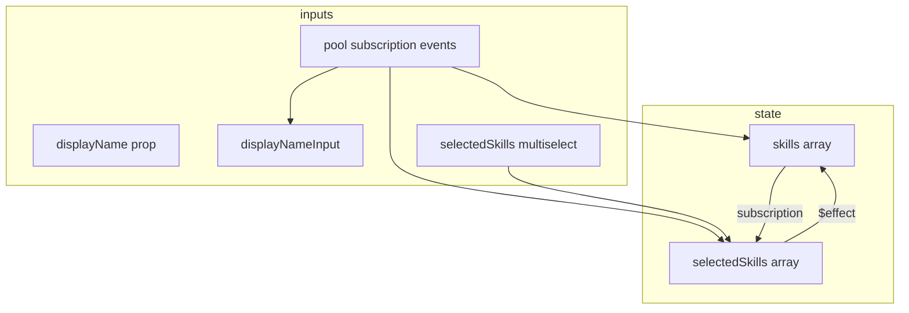
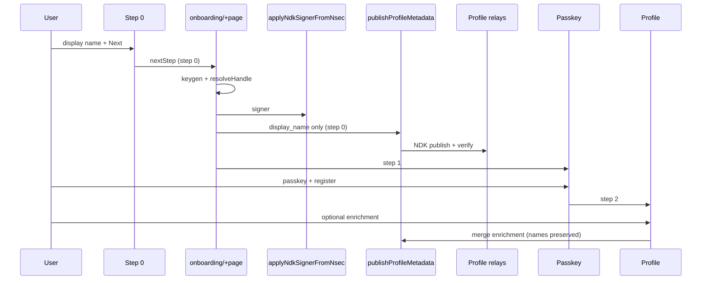

# Profile Metadata — NDK Publish, Relay Verify & Error Handling

**Status:** Phase 1 shipped; Phase 2 review + hardening (documented below)  
**Last updated:** 2026-06-02  
**Scope:** Reliable kind:0 on profile relays; NDK for publish/verify; read/subscribe migration; NIP-compliant wire format; display-name UX rules.

---

## Executive summary

Task cards showed **truncated npub** when kind:0 never reached relays (or lacked usable `name` / `display_name`). Phase 1 added:

1. **NDK publish** for kind:0 with error propagation.
2. **Read-back verify** after publish (pool-based fetch today).
3. **Normal signup:** step 0 publishes minimal kind:0 before passkey; step 2 merges enrichment.
4. **Nsec first signup:** profile step is the publish gate (passkey already exists from login).

**Phase 2 (this document)** captures a post-implementation review: `ProfileSetup.svelte` robustness, incomplete NDK migration, NIP-0 field norms, display-name priority rules, and a simplification plan. **No further code changes until approved** — this section is the source of truth for the next PR.

---

## Onboarding screens (unchanged)

| Step index | Screen             | User-visible label |
| ---------- | ------------------ | ------------------ |
| 0          | `DisplayNameSetup` | Display name       |
| 1          | `PasskeySetup`     | Passkey            |
| 2          | `ProfileSetup`     | Profile            |
| 3          | `RecoverySetup`    | Recovery           |
| 4          | `CompleteSetup`    | Complete           |

---

## Post-implementation review (2026-06-02)

### Summary verdict

Phase 1 solves the **“no kind:0 before passkey”** gap for normal signup. The implementation is **functionally directionally correct** but **not yet production-grade** in three areas:

| Area                  | Phase 1 state                                      | Risk                                                                    |
| --------------------- | -------------------------------------------------- | ----------------------------------------------------------------------- |
| `ProfileSetup.svelte` | Works via implicit mode detection                  | Medium — fragile branching, racey subscription UX                       |
| NDK vs nostr-tools    | Publish = NDK; read/subscribe/images/skills = pool | Medium — relay/cache split, harder debugging                            |
| kind:0 JSON on wire   | `JSON.stringify(mergedMetadata)`                   | Medium — can re-emit legacy keys; app-only fields mixed with NIP fields |

---

### `ProfileSetup.svelte` — detailed findings

#### 1. `const isNsecFirstSignup = !displayName` is a brittle mode switch

**What it does today**

- UI: `{#if !displayName}` shows the display-name input (L377).
- Submit: `isNsecFirstSignup` chooses **full publish** (name + display_name + enrichment) vs **merge-only** enrichment (L272–296).
- Parent wiring:
  - Normal signup: `displayName={formData.displayName}` from `onboarding/+page.svelte` (non-empty after step 0).
  - Nsec path: `auth/+layout.ts` returns `{ currentStep: 2 }` when `ACCESS_TOKEN` exists; `formData.displayName` stays `''` → treated as nsec.

**Why this is “off”**

| Problem                         | Example                                                                                                                                         |
| ------------------------------- | ----------------------------------------------------------------------------------------------------------------------------------------------- |
| **Implicit contract**           | Any caller that passes empty/whitespace `displayName` by mistake triggers nsec behavior (full publish + visible name field).                    |
| **Not the same as “nsec user”** | Token + step 2 also happens for passkey users who refresh mid-onboarding; `displayName` may be empty in memory even if kind:0 exists on relays. |
| **Duplicated name state**       | `displayName` (prop), `displayNameInput` (local), subscription writes (L74–75), and `(displayName \|\| displayNameInput)` on submit (L234).     |
| **UI/logic coupling**           | Visibility of a field and publish strategy share one boolean derived from a string prop.                                                        |

**Recommended replacement (no new files — prop on existing component)**

```typescript
// Explicit mode — set from parent from route/layout facts, not from string emptiness
type ProfileSetupMode = 'signup_enrichment' | 'nsec_first_publish';

// signup_enrichment: display name from step 0; hidden field; merge-only publish
// nsec_first_publish: show display name input; full kind:0 on submit
```

Parent sets mode from:

- `signup_enrichment` when `formData.displayName` is set (normal wizard).
- `nsec_first_publish` when layout skipped to step 2 with token and no step-0 name in parent state (or dedicated layout flag).

Use `displayName.trim()` for guards, not falsy `displayName` alone.

---

#### 2. Normal-signup merge path can still publish a “thin” kind:0

**Flow (L283–295)**

1. `getProfileMetaData(npub)` via **nostr-tools pool** (not NDK).
2. If `null` (relay lag, wrong relay set, or race after step 0), `existingMetadata = {}`.
3. `publishProfileMetadata(enrichment, existingMetadata)` — enrichment has **no** `name` / `display_name`.
4. `mergeProfileMetadata` only copies keys **present** in `metadata`; it does not delete existing keys from spread — but the **new event’s JSON** is only `{ professionalTitle, about, picture, translations, … }` if spread source was empty.

**Risk:** Verify can pass (fallback `requiredDisplayName` uses `formData.displayName` at L289–294) while the **published** kind:0 event on relays lacks `name`/`display_name`, so other clients still show npub.

**Hardening rule:** On `signup_enrichment`, always inject fallback before merge:

```typescript
const nameFallback = displayName.trim();
// If existingMetadata lacks names, set name + display_name from step 0 before merge
```

Or **fail closed** if `getProfileMetaData` returns null within N seconds after step 0.

---

#### 3. Live subscription is still nostr-tools, not NDK

`onMount` calls `subscribeToProfileUpdates` from `profile.ts` (L65–141):

- Uses `appStore.pool.subscribe` (SimplePool).
- Multiplexes kinds 0, 30063, 30000 with tag filters.
- Sets `isInitialLoading = true` on **every** `onevent` (L68) → skeleton flicker on each relay update.
- Overwrites `displayNameInput` from `metadata.display_name || metadata.displayName || metadata.name` (L74–75) — read order differs from canonical NIP priority in some other modules.
- Can overwrite `selectedSkills` while user edits (L125–126).

**For onboarding step 2**, a **one-shot** `getProfileMetaData` / NDK `fetchEvent` after step 0 may be enough; live subscription adds complexity for little benefit during a short wizard step.

---

#### 4. Circular / complex reactivity



**Issues**

- `$effect` (L200–223) syncs `selectedSkills` → `skills` with a set-equality guard — good intent, still hard to reason about vs subscription writes.
- Image `onChange` (L365–371): comment says clear picture; logic is a no-op when `picture` already set — stale preview risk.

---

#### 5. Split stack on submit

| Step                | API                                                    | Transport                     |
| ------------------- | ------------------------------------------------------ | ----------------------------- |
| `ensureNdkSigner`   | `applyNdkSignerFromNsec` / `syncNdkSignerFromAppStore` | NDK                           |
| `handleImageUpload` | `publishMultipleImages`                                | **pool**                      |
| kind:0              | `publishProfileMetadata`                               | **NDK**                       |
| skills              | `publishSkillsUpdate`                                  | **pool** (awaited in Phase 1) |
| verify              | `fetchProfileMetadata`                                 | **pool** + `DEFAULT_RELAYS`   |

Publish and verify can disagree if `appStore.relays` ≠ `VITE_NOSTR_RELAY_URL` parsing.

---

### `subscribeToProfileUpdates` — not NDK (gap vs “fully NDK”)

**Two different functions share one name:**

| Location                         | Signature                           | Purpose                                 |
| -------------------------------- | ----------------------------------- | --------------------------------------- |
| `src/lib/nostr/profile.ts`       | `(callback, kindFilters?, relays?)` | Own profile: multi-kind live updates    |
| `src/lib/utils/nostr-message.ts` | `(pubkey, callback, relays?)`       | Other users: name/avatar hints for chat |

Both use **SimplePool**, not `ndk.subscribe`.

**Related pool-only paths in `profile.ts`**

- `getProfileMetaData` — `pool.get`
- `publishMultipleImages`, `deleteNostrEvent`, portfolio/availability publishers
- `closeNostrPool` — closes subscriptions **and** `pool.close(relays)` (shared pool — affects non-profile features)

**Phase 1 checklist item “NDK publish” is done; “fully NDK” for profile is not.**

See [NDK migration phases](#ndk-migration-phases-read--subscribe) below.

---

## Display name priority (product rule)

**Rule (must hold everywhere in UI):**

1. **Best:** Human-readable display name from kind:0 (sanitized).
2. **Better than “Unknown” / `undefined`:** Truncated **npub** (or hex-derived label).
3. **Never show:** literal `"Unknown user"`, `"undefined"`, raw 64-char hex, or `npub1…` full string as the “name”.

**Canonical read order for kind:0 JSON** (NIP-24 + legacy compat):

```text
display_name  →  displayName (deprecated)  →  name
```

**Reference implementation:** `sanitizeProfileDisplayName` + `fetchProfileMetadata` in `nostr-message.ts` (kind 0 one-shot fetch).

**`UserInfoDisplay.svelte` chain (correct pattern):**

```text
fetchedProfile.name (already resolved via fetch)  →  username prop  →  truncateNpub(pubkey)
```

**Inconsistencies to fix in Phase 2**

| Location                                       | Issue                                                                   |
| ---------------------------------------------- | ----------------------------------------------------------------------- |
| `nostr-message.ts` subscription handler (live) | Uses `content.name \|\| content.displayName` — **skips `display_name`** |
| `ProfileSetup` subscription (L74–75)           | Order is `display_name \|\| displayName \|\| name` — OK for read        |
| `profile.store`                                | Uses `display_name \|\| name` — omits deprecated `displayName`          |

**Action:** One shared pure function `resolveDisplayNameFromKind0Content(content: unknown): string | undefined` used by fetch, subscribe, store, and onboarding. No behavior change on read priority — only consistency.

---

## NIP-0 metadata — publish vs read (normative)

Sources: [NIP-01](https://github.com/nostr-protocol/nips/blob/master/01.md) (kind 0), [NIP-24](https://github.com/nostr-protocol/nips/blob/master/24.md) (extensions + **deprecated** aliases).

### What to **publish** on new events (BitTasker policy)

**Always use snake_case. Never emit deprecated or duplicate aliases.**

| Field                                                              | Publish?                                                                        | NIP                               |
| ------------------------------------------------------------------ | ------------------------------------------------------------------------------- | --------------------------------- |
| `display_name`                                                     | **Yes** — only field BitTasker broadcasts for the human label                   | NIP-24                            |
| `name`                                                             | **Never broadcast** by BitTasker (read fallback only for other clients' events) | NIP-01 / 24                       |
| `about`, `picture`, `website`, `banner`, `nip05`, `lud16`, `lud06` | When user provides them                                                         | NIP-01 / 24 / 57                  |
| `displayName`                                                      | **Never**                                                                       | Deprecated in NIP-24              |
| `username`                                                         | **Never**                                                                       | Deprecated in NIP-24 (use `name`) |

**App-specific extensions** (`professionalTitle`, `location`, `translations`, …):

- Allowed in BitTasker today for product features.
- **Not** NIP-standard — other clients ignore them.
- Phase 2 option A: keep publishing them (current behavior).
- Phase 2 option B (stricter interop): publish **NIP fields only** on kind:0; move extensions to separate kinds (30000+ already used for skills).

**User request (2026-06-02):** For **new** events, never broadcast deprecated keys (`displayName`, `username`). Use **`display_name` as the norm**; omit `name` when it would equal `display_name`. Reading still accepts legacy keys.

**Implementation (shipped):** `buildProfileMetadataWire(merged)` constructs the wire JSON from scratch — only `display_name` for the human label (never `name`, `displayName`, or `username` on broadcast). No post-hoc sanitize/strip step.

```typescript
// publishProfileMetadata — wire is built, not merged JSON.stringify
const wireMetadata = buildProfileMetadataWire(mergedMetadata);
ndkEvent.content = JSON.stringify(wireMetadata);
```

### What to **read** (backward compatible)

| Logical value | Resolution order                                     |
| ------------- | ---------------------------------------------------- |
| Display label | `display_name` → `name` → `displayName` → `username` |
| Handle        | `name` → `username` (deprecated)                     |

Do **not** remove fallbacks in parsers, tests, or `user.store` — only stop **writing** deprecated keys.

### Step 0 / nsec / step 2 publish payloads (target)

| Step             | Publish JSON (minimum)                                                                                      |
| ---------------- | ----------------------------------------------------------------------------------------------------------- |
| 0 (normal)       | `{ "display_name": "…" }` only (no duplicate `name`)                                                        |
| 2 (normal merge) | Add `about`, `picture`, `professionalTitle`, … — preserve relay `display_name`; add `name` only if distinct |
| 2 (nsec)         | `{ "display_name": "…", …enrichment }` in one event                                                         |

**Not:** duplicate `name` when equal to `display_name`; never `displayName` / `username` on wire.

---

## Normal signup — UX (reference)

### Sequence



### Step 2 merge rules

1. Fetch latest kind:0 (prefer **same relay set** as publish).
2. Merge enrichment; **never** clear `name` / `display_name` with empty strings.
3. Strip deprecated keys before publish.
4. Verify display name still matches step 0 name.

---

## Nsec first signup — UX (reference)

| Constraint                         | Implication                                          |
| ---------------------------------- | ---------------------------------------------------- |
| Passkey before profile step        | Cannot publish before passkey in wizard              |
| Layout `currentStep: 2` when token | Steps 0–1 skipped                                    |
| Gate                               | Profile submit: publish + verify → then `nextStep()` |

Use **`nsec_first_publish` mode** (explicit), not `!displayName`.

---

## NDK migration phases (read + subscribe)

Phase 1 ✅ **Publish** kind:0 via `NDKEvent.publish`.

Phase 2a ✅ **Auth profile I/O (signup/login/onboarding step 2):** verify, `getProfileMetaData`, `loadAuthProfileSnapshot`, `fetchKind0ProfileNdk`, step-2 images/skills publish — **NDK only** (no nostr-tools pool on these paths).

| Phase                                | Scope                                                                                                                      | Replace                                                       |
| ------------------------------------ | -------------------------------------------------------------------------------------------------------------------------- | ------------------------------------------------------------- |
| **2a** ✅                            | Auth: verify + fetch + snapshot + kind:0 publish helpers                                                                   | `ndk.fetchEvent` / `ndk.fetchEvents` on **`profileRelays()`** |
| **2b**                               | Rename `profile.ts` → `subscribeToOwnProfileEvents`; migrate to `ndk.subscribe`; remove `pool.close` from `closeNostrPool` | Live own-profile                                              |
| **2c**                               | Rename `nostr-message` → `subscribeToUserProfileHints`; align live read order with fetch                                   | Chat / others                                                 |
| **2d** ✅ (auth + shared publishers) | `publishMultipleImages`, `publishSkillsUpdate` for onboarding/profile edit                                                 | NDK `publishSignedNdkEvent`                                   |
| **3**                                | App-wide pool retirement                                                                                                   | Out of scope until tasks/DMs migrated                         |

**Pitfall:** `verifyProfileMetadataOnRelays` must use **`ONLY_RELAY`** (or equivalent) when confirming post-publish — not stale Dexie/cache-only reads.

---

## Simplification plan (quality / maintainability)

Goal: **thin UI**, **fat pure helpers in `profile.ts`**, one relay list, one display-name resolver.

### 1. Explicit onboarding mode (ProfileSetup)

- Add `mode: 'signup_enrichment' | 'nsec_first_publish'` prop from parent.
- Remove `isNsecFirstSignup = !displayName`.
- Single source for display name on submit: `getEffectiveDisplayName(mode, displayName, displayNameInput)`.

### 2. Reduce onboarding subscription scope

- Replace live `subscribeToProfileUpdates` on step 2 with:
  - **Option A:** one-shot `loadOwnProfileSnapshot()` after mount (NDK or pool, then unify).
  - **Option B:** subscription only if editing existing profile (logged-in), not fresh signup.

### 3. Pure functions in `profile.ts` (no new files)

| Function                             | Responsibility                                     |
| ------------------------------------ | -------------------------------------------------- |
| `resolveDisplayNameFromKind0Content` | Read priority (`display_name` → `name` → …)        |
| `buildKind0WireMetadata`             | Wire JSON: norm fields only; omit duplicate `name` |
| `buildEnrichmentMetadata(form)`      | Map UI → `NostrProfile` partial                    |
| `mergeProfileMetadata`               | Merge enrichment before `buildKind0WireMetadata`   |

### 4. Single relay constant

```typescript
const profileRelays = () => get(appStore)?.relays ?? [];
```

Use for publish, verify, fetch, subscribe — **never** silent `DEFAULT_RELAYS` split for profile flows.

### 5. Fix naming collision

- `profile.ts`: `subscribeToOwnProfileEvents`
- `nostr-message.ts`: `subscribeToUserProfileHints`

### 6. `ProfileSetup` size target

- Move submit orchestration to `completeProfileSetup({ mode, nsec, npub, displayName, form })` in `profile.ts`.
- Component: bind form fields, call one orchestrator, show errors.

---

## Error handling

| Event                       | Stay on step |
| --------------------------- | ------------ |
| Step 0 publish/verify fails | 0            |
| Passkey/register fails      | 1            |
| Step 2 publish/verify fails | 2            |
| Image/skills publish fails  | 2            |

i18n: `onboarding_auth.form.profile_publish.*` (en/es).

---

## Implementation checklist

### Phase 1 (shipped)

- [x] `publishProfileMetadata`: NDK + verify + safe merge (preserve display name).
- [x] `publishSkillsUpdate` / `uploadCertification`: await + throw.
- [x] `+page.svelte`: step 0 gate — publish+verify before passkey.
- [x] `DisplayNameSetup`: loading/error on step 0 Next.
- [x] `PasskeySetup`: no keygen; no publish.
- [x] `ProfileSetup`: merge vs full publish split (explicit `ProfileSetupMode`).
- [x] `login/+page.svelte`: NDK signer + appStore keys after nsec login.
- [x] Unit tests: `profile.publish.test.ts`.

### Phase 2 (auth profile — shipped)

- [x] Replace `!displayName` with explicit `ProfileSetupMode` prop (`signup_enrichment` | `nsec_first_publish`).
- [x] Signup merge: fail closed when relay kind:0 has no display name (`PROFILE_METADATA_MISSING`).
- [x] `buildKind0WireMetadata` — never emit `displayName` / `username`; omit `name` when equal to `display_name`.
- [x] App extensions (`professionalTitle`, `translations`, …) still on wire (product decision unchanged).
- [x] `resolveDisplayNameFromKind0Content`: `display_name` → `name` → `displayName` → `username`.
- [x] `nostr-message` live subscription read order aligned.
- [x] Verify + `getProfileMetaData` + onboarding snapshot via NDK; `profileRelays()`.
- [x] ProfileSetup: no `$effect`; one-shot `loadAuthProfileSnapshot` on mount (no pool subscription).
- [x] `publishMultipleImages` / `publishSkillsUpdate` via NDK (requires `ndk.signer`).
- [ ] Migrate `subscribeToProfileUpdates` (profile edit / chat) to `ndk.subscribe` — out of auth scope.
- [ ] E2E: `01-signup-onboarding.spec.ts` + nsec path display name on relays.
- [ ] `docs/auth/flows.md` after Phase 2.

---

## Files involved

`profile.ts`, `ndk.ts`, `nostr-message.ts`, `profile-cache.ts`, `onboarding/+page.svelte`, `ProfileSetup.svelte`, `DisplayNameSetup.svelte`, `login/+page.svelte`, `UserInfoDisplay.svelte`, `PersonalInfo.svelte`, `auth/+layout.ts`, locale JSON, tests.

---

## Definition of done (full program)

- [x] Normal: step 0 verified minimal kind:0 before passkey.
- [x] Normal: step 2 merge preserves relay display name via `buildKind0WireMetadata`.
- [x] Nsec: profile step publish gate.
- [x] Auth signup/login/onboarding profile **read/publish/verify** on NDK (edit/chat subscriptions still pool).
- [x] Publish never emits `displayName` / `username`; duplicate `name` omitted when same as `display_name`.
- [ ] UI display: name → npub truncate; never Unknown/undefined.
- [x] `ProfileSetup` uses explicit mode; no `$effect` for skills sync.

---

## Decision log

| Date       | Decision                                                                                               |
| ---------- | ------------------------------------------------------------------------------------------------------ |
| 2026-06-02 | Keygen on step 0 `nextStep`, not `PasskeySetup`                                                        |
| 2026-06-02 | Block passkey until step 0 publish+verify succeeds                                                     |
| 2026-06-02 | Step 2 merge only for normal signup                                                                    |
| 2026-06-02 | Nsec: passkey before profile; gate on profile step only                                                |
| 2026-06-02 | Phase 1 shipped without full NDK read/subscribe migration                                              |
| 2026-06-02 | **Publish:** snake_case only; **never** `displayName`/`username` on new events                         |
| 2026-06-02 | **Read:** `display_name` → `displayName` → `name`; keep fallbacks                                      |
| 2026-06-02 | Replace `!displayName` mode detection with explicit `ProfileSetupMode`                                 |
| 2026-06-02 | Display UX: real name > truncated npub > never Unknown/undefined                                       |
| 2026-06-02 | **Wire:** `buildKind0WireMetadata` — `display_name` norm; omit duplicate `name`; never deprecated keys |
| 2026-06-02 | **Auth I/O:** NDK fetch/publish/verify; ProfileSetup one-shot snapshot; no pool on onboarding step 2   |
| 2026-06-02 | **Read order:** `display_name` → `name` → `displayName` → `username`                                   |
| 2026-06-02 | Avoid `$effect` in ProfileSetup; build skills on submit only                                           |
