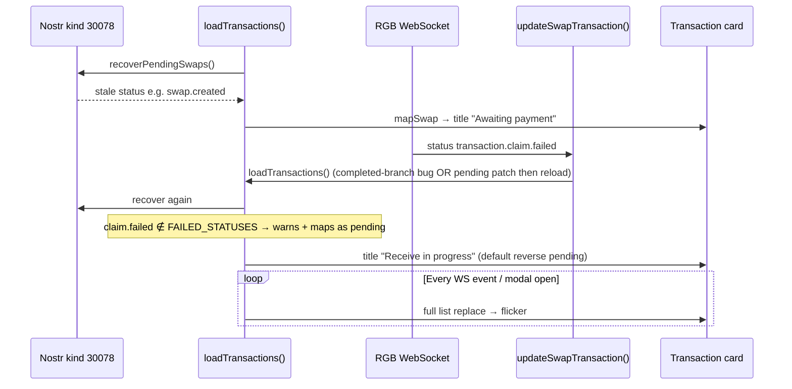
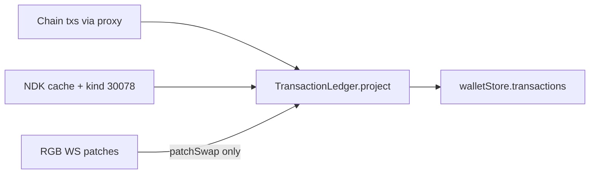
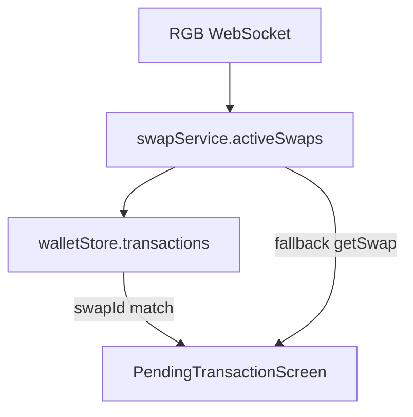

# Wallet Transaction History — Investigation & Full Implementation Plan

**Date:** 2026-06-05 (revised with user feedback)  
**Status:** Analysis complete — ready for single-pass implementation  
**Scope:** Logic and data layer only; **UI markup/styling unchanged** (`TransactionHistory.svelte`, `PendingTransactionScreen.svelte` layout).  
**Confidence:** ≥95% on root causes, swap-type mapping, and implementation strategy (verified against source, [RGB lifecycle docs](https://api.docs.rgb.exchange/lifecycle.html), Blockscout API, production stack traces, and web research).

---

## 1. Executive summary

Production failures cluster around **three interacting bugs** plus **one long-standing UX gap** (decorative countdown modal):

| Issue                                                                                                                      | Severity                   | Root cause                                                                                                                                                                                                                                                                                                                                                                                                                                   |
| -------------------------------------------------------------------------------------------------------------------------- | -------------------------- | -------------------------------------------------------------------------------------------------------------------------------------------------------------------------------------------------------------------------------------------------------------------------------------------------------------------------------------------------------------------------------------------------------------------------------------------- |
| Infinite reload / UI freeze when Transactions modal open during swap                                                       | **P0**                     | `updateSwapTransaction()` triggers full `loadTransactions()` without terminal-state guards; store `rawStatus` never updated on completed branch → every WS event re-triggers reload                                                                                                                                                                                                                                                          |
| Console spam `Unknown swap status: transaction.claim.failed` + title flicker (“Receive in progress” ↔ “Awaiting payment”) | **P0**                     | `transaction.claim.failed` missing from status constants → mapped as **pending**; each `loadTransactions()` **replaces** entire list from Nostr recovery (stale `swap.created`) then WS overwrites → oscillation                                                                                                                                                                                                                             |
| Duplicate “Received” rows (+3,332 sats, failed X + success ✓)                                                              | **P1**                     | Failed EtherSwap `claim()` on-chain ([tx `0x784b6e…](https://rgb.blockscout.com/tx/0x784b6e6e59fdfa0d09b9e467284e6ac7e0c2256a429b91ff0e825f4b689f5499)`) + later successful claim; hash-only dedup; swap claim rows always titled `wallet.received`even when`status: error`                                                                                                                                                            |
| Blockscout CORS / 503 console noise                                                                                        | **P1** (amplified by loop) | Browser `fetch` to `rgb.blockscout.com` from `bittasker.com`; **infinite loop multiplies requests** → rate limits (429/503) often surface as CORS errors when error responses omit `Access-Control-Allow-Origin` ([Blockscout limits](https://docs.blockscout.com/devs/apis/requests-and-limits), [SO #59439345](https://stackoverflow.com/questions/59439345/catch-javascript-fetch-failing-with-cloudflare-429-missing-cors-header)) |
| Pending send modal countdown disconnected from reality                                                                     | **P1** (UX)                | `PendingTransactionScreen` uses fixed timer; swap monitoring code **commented out**; `SendPaymentForm` stores `pendingSwapId` but **never passes it** to the modal                                                                                                                                                                                                                                                                           |
| Wrong `balanceAfter` on swap cards                                                                                         | **P1**                     | Swaps use live wallet balance, not unified running balance                                                                                                                                                                                                                                                                                                                                                                                   |

**Not the cause:** `swapAdapter.ts` commit `cfcc9391` (only `randomBytes` → `getRandomValues`). bolt11/crypto-browsify shims are outside the reload path.

**Implementation approach:** One coordinated delivery — no partial/phased rollouts. NDK migration for swap storage is **required**, not optional.

---

## 2. Swap types — terminology (read this first)

RGB defines exactly **three** atomic swap types ([lifecycle docs](https://api.docs.rgb.exchange/lifecycle.html)). There is **no** “Lightning → Lightning” RGB swap.

| What the user experiences                                          | RGB / BitTasker type                                   | On-chain role                                                               | Who calls `EtherSwap.claim()`?                                  |
| ------------------------------------------------------------------ | -------------------------------------------------------- | --------------------------------------------------------------------------- | --------------------------------------------------------------- |
| **Pay a Lightning invoice** (e.g. send $2 to Blink from BitTasker) | **Submarine** (Normal Submarine Swap: Chain → Lightning) | User locks **BTC** in `EtherSwap.lock()` on RGB; RGB pays the LN invoice | **RGB** (after `invoice.paid`); user does **not** claim       |
| **Receive Lightning** (e.g. generate invoice, Blink pays you)      | **Reverse** (Reverse Submarine Swap: Lightning → Chain)  | RGB locks BTC after user pays hold invoice                               | **User** (auto-claim in wallet-core on `transaction.confirmed`) |
| **L-BTC ↔ BTC**                                                  | **Chain**                                                | Both sides on-chain                                                         | User                                                            |

**User phrase “Lightning to Lightning”** maps to **paying an external Lightning invoice** — in BitTasker that is always a **submarine send** (`createSubmarineSwap` + `lockSubmarineSwapFunds` in `SendPaymentForm.svelte`), even though both wallets are Lightning-facing. BTC on RGB is the chain leg RGB requires.

**BitTasker code mapping:**

```typescript
// getSwapType() in swapTransaction.ts
// invoice + lockupAddress → submarine
// invoice only (no lockupAddress) → reverse
// else → chain
```

**Critical:** `transaction.claim.failed` is **not** a RGB API status. It is a **wallet-core internal status** set only in `ReverseSwapService.claimBTC()` / `claimBTCViaRifRelay()` catch blocks when **user claim** fails. It **never** applies to submarine swaps (RGB claims on submarine; see `SubmarineSwapService.js` — no `claim.failed` path).

If the console shows `transaction.claim.failed` and titles like “Receive in progress” / “Awaiting payment”, an active **reverse (receive)** swap exists in memory — typically from receiving funds from Blink — **in addition to** any submarine send.

---

## 3. Forensics — Blockscout tx `0x784b6e6e…`

Verified via [Blockscout API](https://rgb.blockscout.com/api/v2/transactions/0x784b6e6e59fdfa0d09b9e467284e6ac7e0c2256a429b91ff0e825f4b689f5499):

| Field         | Value                                                                              |
| ------------- | ---------------------------------------------------------------------------------- |
| Method        | `claim(bytes32 preimage, uint256 amount, address refundAddress, uint256 timelock)` |
| Contract      | `EtherSwap` (`0xE761…1654`)                                                        |
| From          | User wallet `0xbCe4…8fd5`                                                          |
| Result        | **Reverted**                                                                       |
| Revert reason | `EtherSwap: swap has no Ether locked in the contract`                              |
| Amount param  | `33320000000000` wei ≈ **3,332 sats**                                              |
| Status        | `error`                                                                            |

This is unequivocally a **failed reverse-swap user claim**, not a submarine send lockup. It explains the screenshot row: **“Received” +3,332 sats with failed (X) badge** — `transactionHistory.ts` classifies EtherSwap `claim` as `displayType: swap-claim`, title `wallet.received`, while `normalizeStatus('error')` → failed badge.

A **second** successful claim tx (or different hash) produces the duplicate **“Received” +3,332 sats with ✓**.

---

## 4. Current oscillation bug (`transaction.claim.failed`)

### 4.1 What the user sees

- One transaction card cycles: **“Receive in progress”** → **“Awaiting payment”** → repeat.
- Console repeats: `Unknown swap status: transaction.claim.failed` from `getSwapStatusDisplay()` → `mapSwapToTransaction()` inside `loadTransactions()`.

### 4.2 Mechanism (confirmed)



1. `**transaction.claim.failed` ∉ `FAILED_STATUSES**` (`swapTransaction.ts`) → `getSwapStatusDisplay` hits `default` → `console.warn('Unknown swap status')` + `statusUI.pending`.
2. `**transaction.claim.failed` ∉ Nostr `finalStates**` (`swapAdapter.ts`) → swap **never ages out** of recovery.
3. `**loadTransactions()` replaces\*\* the full `transactions` array — any in-place patch from `updateSwapTransaction` is wiped on next reload.
4. Nostr event may lag behind WS (async `pool.publish`) → recovery reads **older** `swap.created` while WS has `claim.failed` or `transaction.mempool` → **title alternates**.
5. Stack trace shows **both** `ReverseSwapService.handleSwapUpdate` and `SubmarineSwapService.handleSwapUpdate` — multiple active swaps from bidirectional $2 tests amplify reloads.

### 4.3 Title mapping reference (reverse swap)

| RGB / SDK status                                   | Title key                                                |
| ---------------------------------------------------- | -------------------------------------------------------- |
| `swap.created`                                       | `wallet.swap.awaiting_payment`                           |
| `transaction.mempool`, `minerfee.paid`               | `wallet.swap.pending_receive`                            |
| `transaction.confirmed`, `transaction.claim.pending` | `wallet.swap.receive_finalizing`                         |
| `transaction.claim.failed`                           | **(missing)** → default `pending_receive` + unknown warn |

Submarine **send** titles use `pending_send` / `send_finalizing` — if the user only did submarine send, oscillation between receive titles implies a **reverse** swap row is in the list.

---

## 5. Root cause — infinite reload loop

**Location:** `updateSwapTransaction()` in `wallet.store.ts` (lines 650–699).

On `invoice.paid` / `invoice.settled` / `transaction.claimed`:

1. `hasChanged === true` (stale `rawStatus`).
2. Calls `loadTransactions()` (Blockscout + Nostr recover + merge).
3. Returns **without** updating store `rawStatus`.
4. Next identical WS event → repeat.

**Amplifiers:** `TransactionHistory` `onMount` → `loadTransactions()`; each reload calls `recoverPendingSwaps()` on all three services; no single-flight mutex (test expects one, code lacks it).

---

## 6. Blockscout / CORS / Cloudflare hosting

### 6.1 What we verified

- Normal RGB Blockscout API responses include `access-control-allow-origin: `\* (curl verification).
- [Blockscout request limits](https://docs.blockscout.com/devs/apis/requests-and-limits): ~300 req/min/IP without API key; **429** when exceeded.
- Browsers often report **429/503 without CORS headers** as “blocked by CORS policy” — indistinguishable from true CORS blocks in `fetch()` ([Blockscout PRO blog](https://www.blog.blockscout.com/build-a-multichain-wallet-portfolio-tracker-with-blockscout-pro-api/), [CORS proxy for Pages](https://www.brachkow.com/notes/cors-proxy-for-cloudflare-pages/)).

### 6.2 Role of the infinite loop

The loop fires **multiple parallel** Blockscout calls per iteration (`loadRGBTransactions` tries 3 fallback URLs + internal txs + token balances). That can trigger rate limits **even when** baseline CORS would work. **Fix the loop first**; CORS noise should drop sharply.

### 6.3 Production today: Cloudflare **Pages**, not Workers

- Current prod: static **Pages** deployment (`bittasker.com`).
- In-progress migration: `workers-site/` Worker with `run_worker_first` for `/api/`\* — **not yet production** for the main app.
- **Worker migration is not the cause** of Blockscout failures on Pages today.
- **Required for production (Pages):** [Cloudflare Pages Functions](https://developers.cloudflare.com/pages/functions/) middleware to proxy `/api/explorer/rgb/`\* → `rgb.blockscout.com` (same pattern as [brachkow CORS proxy](https://www.brachkow.com/notes/cors-proxy-for-cloudflare-pages/)).
- **Required for post-migration (Workers):** mirror route in `workers-site/index.js` (already has Stream handlers).

Both targets share one client config: `VITE_EXPLORER_PROXY_BASE=/api/explorer/rgb`.

---

## 7. RIF Relay & fees (verified)

Per [RGB lifecycle](https://api.docs.rgb.exchange/lifecycle.html) and wallet-core:

| Topic                       | Fact                                                                                                                                                                                                  |
| --------------------------- | ----------------------------------------------------------------------------------------------------------------------------------------------------------------------------------------------------- |
| **RIF Relay scope**         | Used for **gasless BTC claims** on **reverse** and **chain** swaps when user lacks gas or swap was created for Smart Wallet claim address — **not** submarine sends (user pays gas to `lock()` BTC) |
| **Reverse success (RGB)** | Final RGB status: `invoice.settled` after user supplies preimage via claim API                                                                                                                      |
| **Reverse claim (user)**    | Client broadcasts `EtherSwap.claim()` — wallet-core on `transaction.confirmed`                                                                                                                        |
| **Submarine success**       | `invoice.paid` then RGB `transaction.claimed` — user never calls `claim()`                                                                                                                          |
| **Fees in UI**              | Submarine: `invoiceAmount` / lockup amount; Reverse display should use **net receive** (`onchainAmount - claimMinerFee`) per [Zeus #3969](https://github.com/ZeusLN/zeus/pull/3969)                   |
| **Failed claim**            | Revert when lockup not indexed / wrong amount / already claimed — matches Blockscout tx above                                                                                                         |

---

## 8. Target architecture — Unified Transaction Ledger (UTL)

Single delivery replacing ad-hoc merge. **UI components unchanged**; data pipeline rewritten.

### 8.1 Principles

1. **One sorted activity feed** — chain txs + in-flight swaps ([Zeus Activity](https://zeusln.com/blog/new-release-zeus-v0-12-0/), [Breez list_payments](https://sdk-doc-liquid-prerelease.breez.technology/guide/list_payments.html)).
2. **Stable ID:** `swap.id` primary; `preimageHash`, `claimTxHash`, `lockupTxHash` for dedup.
3. **NDK + IndexedDB** for swap event cache (required); Nostr kind `30078` for cross-device encrypted backup.
4. **WebSocket → patch one ledger entry**; full rebuild only: app init, manual refresh, reconnect catch-up (once).
5. **Terminal immutability** — after final/failed terminal status, ignore further WS events for that `swapId`.
6. **Blockscout via same-origin proxy** on web (Pages Functions now, Worker after migration).

### 8.2 Core modules (new / refactored)

```
src/lib/utils/wallet/transactionLedger.ts    — project(), dedup(), unified balance
src/lib/utils/wallet/swapEventLog.ts         — optional audit trail per swapId
src/lib/utils/wallet/swapStatusMap.ts        — all RGB + wallet-core statuses typed
src/lib/nostr/events/rgbSwap.ts            — NDK kind 30078 event class
src/lib/utils/swapAdapter.ts                 — NDK transport (replaces SimplePool)
src/lib/stores/wallet.store.ts               — thin orchestration
functions/api/explorer/[[path]].ts           — Pages Functions proxy (production)
workers-site/handlers/explorer.js            — Worker proxy (post-migration)
```

### 8.3 Ledger projector pipeline



### 8.4 Dedup rules (mandatory)

1. Same `swapId` → **at most one** swap row.
2. If chain `claim` tx matches swap `claimTxHash` or `preimageHash` → drop swap row, keep chain row.
3. Multiple chain claim attempts for same `preimageHash` → show **latest successful**; hide **reverted** attempts when success exists.
4. `transaction.claim.failed` → **one failed terminal row** (not pending); hide when successful claim appears.
5. Submarine completed (`invoice.paid` / `transaction.claimed`) → drop swap row when chain lockup/claim visible or after terminal grace period.

### 8.5 Status constants — complete set

**Add to `FAILED_STATUSES` / `FINAL_STATUSES`:**

- `transaction.claim.failed` (wallet-core reverse only)

**Add to Nostr `finalStates`:**

- `transaction.claim.failed`
- `invoice.paid` (submarine complete — stop recovering)

**Submarine completed (hide row):** `invoice.paid`, `transaction.claimed`  
**Reverse completed (hide row):** `invoice.settled`, `transaction.claimed`  
**Never map terminal failed as pending.**

### 8.6 `updateSwapTransaction` — replacement behavior

- **Pending:** patch single entry in ledger via `TransactionLedger.patchSwap()` — **never** call `loadTransactions()`.
- **Terminal success:** remove swap row immediately; schedule **one** debounced chain refresh (500ms, single-flight).
- **Terminal failed (`claim.failed`, expired, etc.):** patch to failed display; mark terminal in `terminalSwapIds` Set; ignore subsequent WS.
- **Always** persist new `rawStatus` to store before any async work.

### 8.7 `loadTransactions` — replacement behavior

- **Single-flight mutex** — concurrent calls share one promise.
- `**recoverPendingSwaps()` only on:** wallet `initialize()`, WebSocket reconnect — **not\*\* every reload.
- **Debounce** manual refresh (TransactionHistory Refresh button).
- Project through `TransactionLedger.project()` — unified running balance across chain + swap rows.

---

## 9. NDK migration (required)

Swaps **must** move from `nostr-tools` `SimplePool` to global **NDK** with existing `**NDKCacheDexie`\*\* (`cache-{npubPrefix}`) configured in `ndkSigner.ts`.

### 9.1 Why required

| Today (SimplePool)                           | NDK + IndexedDB                                       |
| -------------------------------------------- | ----------------------------------------------------- |
| `querySync` always hits relays on cold start | Cache-first `fetchEvents` — instant recovery          |
| Fire-and-forget `publish` — no retry         | `publishReplaceable` + `unpublishedEventsRetry` queue |
| Bypasses app NDK identity/cache              | Same stack as bids, contracts, profile                |
| Swap path ignores `ndk.cacheAdapter`         | Automatic IndexedDB event cache                       |

### 9.2 Migration steps (`swapAdapter.ts`)

1. Remove `getPool()` / `finalizeEvent` / `getPublicKey` from swap path.
2. `ensureNdkReady()` — `ndk.signer` + `ndk.cacheAdapter` (mirror reviews page guard).
3. **Save:** `NDKEvent` kind `30078`, same NIP-44 ciphertext + tags (`#d`, `#t`, `#s`) → `publishReplaceable()`.
4. **Load:** `ndk.fetchEvents({ authors, kinds: [30078], '#t': [swapType] })` — dedup by `#d`, max `created_at`.
5. **Delete:** `publishDeletionEventNdk()` (existing pattern in `profile/ndk.ts`).
6. Add `NDKRGBSwap` event class + register in `ndkInstance.ts` (align with `NDKBid`).
7. Wire `NostrSwapStorage` to use signer-only (drop constructor `nsec` when signer ready).

**Wire format unchanged** — existing relay events remain readable.

### 9.3 IndexedDB role

NDK Dexie stores **encrypted** kind-30078 events. Decrypted swap snapshots for instant UI come from:

- In-memory `activeSwaps` (wallet-core), plus
- Ledger projector reading latest event per `#d` from NDK cache

No separate Dexie schema required beyond NDK’s cache unless we add an explicit decrypted snapshot table later.

---

## 10. Pending transaction modal — connect to real swap status

**Problem:** After send, `SendPaymentForm` shows `PendingTransactionScreen` with a **cosmetic** countdown (`networkInfo.confirmationTime` or fixed decrement). Swap monitoring in `PendingTransactionScreen.svelte` is **fully commented out**. `sendState.pendingSwapId` is set but **not passed** as a prop.

**Requirement:** Keep the modal shell (countdown UX for stakeholders) but drive state from **real** swap/tx data for **all swap types**.

### 10.1 New props (`PendingTransactionScreen.svelte`)

```typescript
interface Props {
	// existing...
	swapId?: string;
	swapType?: 'submarine' | 'reverse' | 'chain';
}
```

`SendPaymentForm` must pass `swapId={sendState.pendingSwapId}` and `swapType="submarine"` for Lightning sends.

Receive flows (`LightningReceive.svelte`, `LBTCReceive.svelte`, chain) should pass their `swapId` + type when showing the same pending shell.

### 10.2 Status source of truth



Primary: `$transactions.find(tx => tx.swap?.id === swapId)` — already updated by `updateSwapTransaction`.  
Fallback: `walletManager.{submarine|reverse|chain}SwapService.getSwap(swapId)`.

### 10.3 Map RGB status → modal `TransactionStatus`

| Swap type            | RGB statuses                                                    | Modal status              |
| -------------------- | ----------------------------------------------------------------- | ------------------------- |
| **Submarine**        | `swap.created`…`transaction.confirmed`                            | `confirming`              |
| **Submarine**        | `invoice.pending`                                                 | `confirming`              |
| **Submarine**        | `invoice.paid`, `transaction.claimed`                             | `success`                 |
| **Submarine**        | `invoice.failedToPay`, `swap.expired`, `transaction.lockupFailed` | `error`                   |
| **Reverse**          | `swap.created`…`transaction.confirmed`                            | `confirming`              |
| **Reverse**          | `transaction.claim.pending`                                       | `confirming`              |
| **Reverse**          | `invoice.settled`, `transaction.claimed`                          | `success`                 |
| **Reverse**          | `transaction.claim.failed`                                        | `error` (show retry hint) |
| **Reverse**          | `swap.expired`, `transaction.failed`, `transaction.refunded`      | `error`                   |
| **Chain**            | server lockup / claim pending states                              | `confirming`              |
| **Chain**            | `transaction.claimed`                                             | `success`                 |
| **Chain**            | `transaction.lockupFailed` (renegotiate eligible)                 | `confirming` + action     |
| **Chain**            | `swap.expired`, `transaction.failed`                              | `error`                   |
| **BTC direct send** | tx receipt `status === 1`                                         | `success`                 |
| **BTC direct send** | reverted receipt                                                  | `error`                   |

### 10.4 Real countdown (keep visual, fix logic)

Replace fixed timer with **status-derived ETA** via `$derived` + `onMount` interval (do **not** re-enable the commented `$effect` block — it caused a read/write loop):

| Status phase                                          | ETA seed (seconds)                         |
| ----------------------------------------------------- | ------------------------------------------ |
| Submarine `swap.created` / `invoice.set`              | 30 (awaiting lockup confirm)               |
| Submarine `transaction.mempool`                       | 30                                         |
| Submarine `transaction.confirmed` / `invoice.pending` | 60 (RGB paying invoice)                  |
| Reverse `swap.created`                                | 60 (awaiting payer)                        |
| Reverse `transaction.mempool`                         | 45                                         |
| Reverse `transaction.confirmed` / claim pending       | 30                                         |
| Chain server lockup phases                            | 90                                         |
| BTC direct                                           | `networkOptions[network].confirmationTime` |

Implementation (Svelte 5 — **no `$effect` / `store.subscribe`** in `.svelte`):

- `$derived.by` on `$transactions.find(tx => tx.swap?.id === swapId)` + `rawStatus` fallback from `getSwap()`.
- `status` and `displayTimeRemaining` are `$derived` from `mapRGBModalStatus()` + `getSwapEtaSeconds()` − `elapsed`.
- `onMount` interval increments `elapsed`; resets when `rawStatus` phase changes (closure `lastRawStatus`, not `$effect`).
- BTC/BSC direct sends: `pollForConfirmation()` updates `receiptStatus` only.
- Side effects (toasts, `loadAssets`) stay on wallet page `onSwapUpdate`, not in the modal.

### 10.5 `PaymentRequestModal` (receive / QR flows)

Already reactive via `$transactions` + `swapId` (`PaymentRequestModal.svelte` lines 43–47). Extend with:

- Same status→ETA table for any countdown shown in receive QR flow.
- On `transaction.claim.failed`: show error state (not infinite QR wait).
- Wire `onSwapUpdate` to close modal on terminal success (already partial via `status.label === confirmed`).

### 10.6 Chain / BTC / BSC

- **BTC send:** keep `pollForConfirmation()` on `txHash` (already active).
- **BSC USDT:** same receipt polling pattern.
- **Chain swap:** subscribe via `swapId` like submarine/reverse.

---

## 11. Blockscout proxy implementation

### 11.1 Pages Functions (production now)

Create `functions/api/explorer/[[path]].ts`:

- Proxy `GET` to `https://rgb.blockscout.com/api/v2/{path}` (or testnet).
- Handle `OPTIONS` preflight.
- Set `Access-Control-Allow-Origin` for `https://bittasker.com`, `https://dev.bittasker.com`.
- `Cache-Control: public, max-age=15` on list endpoints.

### 11.2 Client changes

- `getExplorerApiUrl()` in `transactionHistory.ts`, `token-balance.service.ts`, `blockscoutTransactionStatus.ts`, and wallet-core config override → `${origin}/api/explorer/rgb/v2` on web.
- Capacitor: use same proxy URL via `VITE_PUBLIC_APP_URL` or direct Blockscout (native has no CORS).

### 11.3 Worker (now)

Add `workers-site/handlers/explorer.js` — same logic as Pages Function for parity.

---

## 12. Full implementation checklist (single delivery)

All items ship together in one PR/release.

### 12.1 Transaction ledger & store

- Implement `TransactionLedger` projector with dedup rules (§8.4)
- Implement `swapStatusMap.ts` — exhaustive RGB + wallet-core statuses
- Rewrite `updateSwapTransaction` (§8.6)
- Rewrite `loadTransactions` with single-flight mutex (§8.7)
- Fix `balanceAfter` — unified running balance after merge
- Hide reverted claim txs when successful claim exists for same `preimageHash`
- Submarine rows: correct send titles; never use reverse receive titles
- Net reverse receive amount (minus claim miner fee)

### 12.2 Status & Nostr

- Add `transaction.claim.failed` to failed/final constants + titles
- Extend Nostr `finalStates`
- Migrate `swapAdapter.ts` to NDK (`publishReplaceable`, `fetchEvents`)
- Add `NDKRGBSwap` + register in `ndkInstance.ts`
- `ensureNdkReady()` before swap recovery in wallet init

### 12.3 Infrastructure

- Pages Functions Blockscout proxy
- Worker explorer handler (parity for migration)
- Env: `VITE_EXPLORER_PROXY_BASE`
- Vite dev proxy for local web testing

### 12.4 Pending modal wiring

- Pass `swapId` + `swapType` from `SendPaymentForm` → `PendingTransactionScreen`
- Swap-aware status via `$derived` + status table (§10.3–10.4) — **not** commented `$effect` polling
- Wire receive/chain flows to same pattern
- Align `PaymentRequestModal` error handling for `claim.failed`

### 12.5 Tests

- `transaction.claim.failed` → failed, not pending, no console warn
- Duplicate WS completed events → one `loadTransactions`
- Dedup: failed + successful claim same preimage → one row
- Submarine send maps to send titles, not receive
- `PendingTransactionScreen` reaches `success` on `invoice.paid`
- Single-flight: parallel `loadTransactions` → one Blockscout round-trip
- NDK swap save/load round-trip (mocked)

### 12.6 SDK coordination (wallet-core bump)

- Claim only after lockup event indexed (retry backoff)
- Do not broadcast empty-calldata claim txs
- Expose `claim.failed` as typed status in `SubmarineSwapStatus` union cleanup (document reverse-only)

---

## 13. Screenshot row reconciliation

| Screenshot row                | Explanation                                                                                                                                                                              |
| ----------------------------- | ---------------------------------------------------------------------------------------------------------------------------------------------------------------------------------------- |
| Received +3,332 failed        | Blockscout reverted `claim()` — [tx `0x784b6e…](https://rgb.blockscout.com/tx/0x784b6e6e59fdfa0d09b9e467284e6ac7e0c2256a429b91ff0e825f4b689f5499)` (reverse receive claim failure) |
| Received +3,332 success       | Later successful EtherSwap `claim` on-chain                                                                                                                                              |
| Receive in progress (flicker) | Reverse swap row with `transaction.claim.failed` or stale Nostr `swap.created` / `transaction.mempool` oscillation                                                                       |
| Finalizing payment −3,275     | **Submarine send** to Blink (`wallet.swap.send_finalizing`) — separate swap                                                                                                              |

User session likely contains **both directions** ($2 to Blink + $2 back), not a single “LN→LN” RGB type.

---

## 14. Files to change

| Area            | Files                                                                                                                                      |
| --------------- | ------------------------------------------------------------------------------------------------------------------------------------------ |
| Ledger          | `transactionLedger.ts` (new), `swapStatusMap.ts` (new), `wallet.store.ts`                                                                  |
| Swap UI mapping | `swapTransaction.ts`, `transactionHistory.ts`                                                                                              |
| NDK             | `swapAdapter.ts`, `nostr/events/rgbSwap.ts` (new), `ndkInstance.ts`, `ndkSigner.ts`                                                      |
| Proxy           | `functions/api/explorer/[[path]].ts` (new), `workers-site/handlers/explorer.js` (new), `workers-site/index.js`                             |
| Pending modal   | `PendingTransactionScreen.svelte`, `SendPaymentForm.svelte`, `LightningReceive.svelte`, `LBTCReceive.svelte`, `PaymentRequestModal.svelte` |
| Config          | `.env.example`, `vite.config.ts`                                                                                                           |
| Tests           | `swapTransaction.test.ts`, `wallet.store.functions.test.ts`, `transactionLedger.test.ts` (new), `PendingTransactionScreen` tests           |

**Do not change:** `TransactionHistory.svelte` template/CSS structure, filter tabs, pagination layout.

---

## 15. Manual test plan

- Submarine: pay Blink invoice — pending modal reaches success on `invoice.paid`; Transactions shows **send** titles, no flicker
- Reverse: receive from Blink — claim failure shows **one** failed row; retry → single success row
- Open Transactions during active swap — no infinite console, no freeze
- Web `bittasker.com` — Blockscout via `/api/explorer/rgb`, no CORS spam
- Refresh mid-swap — NDK cache recovers correct status (not `swap.created` flash)
- Logout/login — swap state via NDK + kind 30078 on second device
- BTC direct send — pending modal via receipt polling unchanged

---

## 16. References

- [RGB swap types & states](https://api.docs.rgb.exchange/lifecycle.html)
- [RGB API v2 WebSocket](https://api.docs.rgb.exchange/api-v2.html#websocket)
- [Blockscout API limits](https://docs.blockscout.com/devs/apis/requests-and-limits)
- [Blockscout portfolio tracker / CORS note](https://www.blog.blockscout.com/build-a-multichain-wallet-portfolio-tracker-with-blockscout-pro-api/)
- [Cloudflare Pages CORS proxy pattern](https://www.brachkow.com/notes/cors-proxy-for-cloudflare-pages/)
- [Failed claim tx on Blockscout](https://rgb.blockscout.com/tx/0x784b6e6e59fdfa0d09b9e467284e6ac7e0c2256a429b91ff0e825f4b689f5499)
- [Zeus swap history v0.12](https://zeusln.com/blog/new-release-zeus-v0-12-0/)
- [Breez SDK list_payments](https://sdk-doc-liquid-prerelease.breez.technology/guide/list_payments.html)
- BitTasker: `wallet.store.ts`, `swapTransaction.ts`, `swapAdapter.ts`, `PendingTransactionScreen.svelte`, `SendPaymentForm.svelte`
- Related: `docs/payments-v2/wallet-transaction-history-v2-plan.md` (escrow/contract rows — unchanged scope)

---

## 17. Summary

| Misconception                      | Correction                                                                                    |
| ---------------------------------- | --------------------------------------------------------------------------------------------- |
| “Lightning → Lightning” RGB swap | **Submarine send** (BTC lock → RGB pays LN invoice)                                        |
| `transaction.claim.failed` on send | **Reverse receive only** (wallet-core); indicates failed `EtherSwap.claim()`                  |
| CORS caused by Worker migration    | **Pages browser fetch** + **loop-amplified rate limits**; fix loop + add Pages Function proxy |
| NDK migration optional             | **Required** — swaps must use NDK IndexedDB cache like rest of app                            |
| Phased rollout acceptable          | **Single full implementation** per this document                                              |

The highest-impact code paths are: treat `transaction.claim.failed` as **terminal failed** (stops warn + flicker), stop `loadTransactions` inside the WS hot path, and wire `PendingTransactionScreen` to `swapId` with real RGB status mapping.
